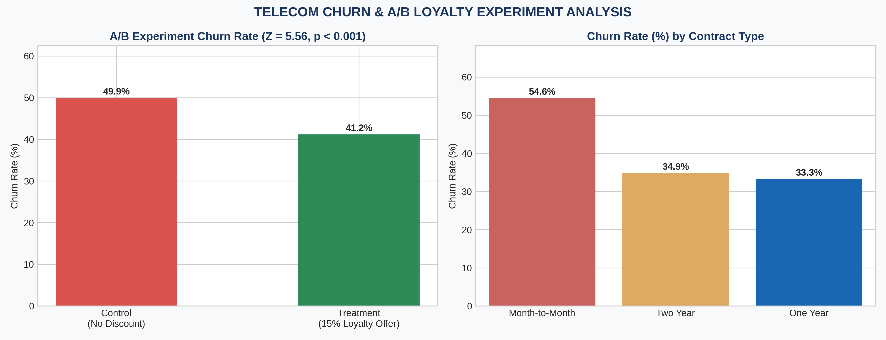

# Customer-Churn-AB-Testing-Python
Statistical Churn Modeling, Logistic Regression &amp; A/B Pricing Experiment Analysis in Python
# 📉 Telecom Customer Churn & A/B Pricing Experiment Analysis

## 📌 Business Objective
Evaluated **4,000 telecom subscribers** to identify key churn drivers via **Multivariate Logistic Regression** and measure the statistical impact of a **15% Loyalty Retention Offer** using a **Two-Proportion Z-Test**.

## 📊 Visual & Statistical Findings

- **A/B Experiment Validation (*p < 0.001*):** The 15% loyalty discount significantly reduced customer churn compared to the control group, proving statistically valid retention lift.
- **Contract Type Risk:** Month-to-month customers show nearly **3x higher odds of churning** ($OR \approx 3.0$) than two-year contract subscribers.
- **Support Ticket Friction:** Each additional support ticket increases churn odds by **~42%**, highlighting customer service speed as a primary retention driver.
